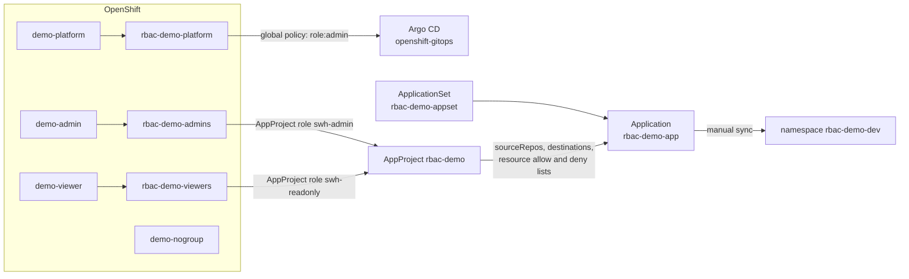

# Hands-on Guide: Testing Argo CD AppProject and RBAC

## Purpose

This guide walks you through a small, self-contained lab that shows how an Argo CD
**AppProject** and **OpenShift groups** work together to control **who can do what** to
Argo CD Applications, and **what those Applications are allowed to deploy**.

The lab is built on the same Argo CD deployment as [Install.md](Install.md): the same work
directory, the same `cpd_vars.sh` variables, the same Argo CD instance, the same Git repo and
the same ApplicationSet-based flow with manual sync. Its test AppProject (`rbac-demo`) copies
the structure of the real [`appproject/argocd-project.yaml`](../appproject/argocd-project.yaml)
(same fields, same role names, same policies, same blacklists). What you learn here therefore
carries over directly to the `ibm-software-hub` AppProject.

The lab uses its own project, namespaces, users, groups and Git branch. It does **not** touch
the `ibm-software-hub` AppProject, the IBM Software Hub namespaces or the working tree you use
for the installation. Read [ArgoCD-AppProject-Best-Practices.md](ArgoCD-AppProject-Best-Practices.md)
and [ArgoCD-RBAC-OCP-Groups.md](ArgoCD-RBAC-OCP-Groups.md) for the background.

> **Status: not yet validated on a live cluster.** The commands follow the behavior
> documented for OpenShift GitOps and Argo CD, but they have not been run end to end.
> Command output and error text can differ between Argo CD versions. If something behaves
> differently, treat the "Expected" column as the intent and check the documentation for your
> version.

> **Use a lab or test cluster.** Step 2 changes the cluster OAuth configuration and Step 4
> changes the Argo CD RBAC settings. Both affect every user of the cluster, including users
> of an existing `ibm-software-hub` deployment.

---

## 1. What you are going to build

Two independent controls are involved. Keep them apart in your mind:

| Control | Question it answers | Configured in |
|---|---|---|
| **RBAC** | Which **person** may do which action on which Application? | OpenShift groups, Argo CD global RBAC, AppProject `roles` |
| **AppProject governance** | What may the **Application** deploy, from where, and to where? | AppProject `sourceRepos`, `destinations`, resource allow and deny lists |



| User | Group | Argo CD permission | Purpose of the test |
|---|---|---|---|
| `demo-platform` | `rbac-demo-platform` | Global `role:admin` | Platform team: manages projects, repos, clusters |
| `demo-admin` | `rbac-demo-admins` | Project role `swh-admin` | Application owner: sync and manage apps in `rbac-demo` only |
| `demo-viewer` | `rbac-demo-viewers` | Project role `swh-readonly` | Auditor: view only, cannot change anything |
| `demo-nogroup` | none | none | Proves that a valid login alone gives no access |

The lab maps to the real deployment like this:

| Lab | Real deployment ([Install.md](Install.md)) |
|---|---|
| AppProject `rbac-demo` | AppProject `ibm-software-hub` (`ARGOCD_APPLICATION_PROJECT`), applied in 3.13 |
| Roles `swh-readonly`, `swh-admin` | The same two roles in `appproject/argocd-project.yaml` |
| Groups `rbac-demo-*` | `ibm-swh-viewers`, `ibm-swh-admins`, `ibm-swh-platform` ([ArgoCD-RBAC-OCP-Groups.md](ArgoCD-RBAC-OCP-Groups.md)) |
| Namespace `rbac-demo-dev` | `PROJECT_CPD_INST_OPERATORS`, `PROJECT_CPD_INST_OPERANDS`, `PROJECT_LICENSE_SERVICE` |
| ApplicationSet `rbac-demo-appset` | The cluster-scoped and namespace-scoped ApplicationSets applied in 3.19 |
| Application without automated sync | The generated Applications. Auto sync is disabled, so you sync them manually. |

---

## 2. Prerequisites

### Parts of Install.md that must be done

You do not need to complete the whole installation. The lab needs only these parts:

| Install.md section | Why the lab needs it |
|---|---|
| [3.1](Install.md#31-set-up-workstation) and [3.2](Install.md#32-creating-an-environment-variables-file) | The work directory `$ARGOCD_DIR` and `cpd_vars.sh` with `PROJECT_ARGOCD`, `ARGOCD_APPSET_CONFIG_GIT_REPO_URL`, `ARGOCD_APPSET_CONFIG_GIT_REPO_BRANCH`, `HELM_REPO_URL` and `ARGOCD_APPLICATION_PROJECT` |
| [3.4](Install.md#34-log-into-the-ocp-cluster) | You are logged in to the cluster as a cluster administrator |
| [3.6](Install.md#36-argo-cd-repository-registration) | The Argo CD CLI is installed, and the Git repo is registered in Argo CD |
| [3.8](Install.md#38-grant-argo-cd-access) | The Argo CD application controller can create resources in new namespaces (it has `cluster-admin`) |
| [3.12](Install.md#312-clone-the-gitops-tech-preview-git-repo-to-your-local-workstation) | The Git repo is cloned in `$ARGOCD_DIR/gitops-tech-preview`, with the same branch as `ARGOCD_APPSET_CONFIG_GIT_REPO_BRANCH` |

Section 3.5 (custom health checks) is not required. The lab changes only `spec.rbac` of the
`ArgoCD` resource, with a merge patch like the one in 3.5, so the two do not conflict.

### Other requirements

- OpenShift GitOps with the default Argo CD instance `openshift-gitops` (`PROJECT_ARGOCD`).
- The tools `oc`, `jq`, `htpasswd` (from `httpd-tools`), `openssl` and `git`. The `argocd` CLI
  comes from 3.6.
- Permission to push a test branch to the Git repo in `ARGOCD_APPSET_CONFIG_GIT_REPO_URL`. Use
  the same access token as in the Install.md prerequisites, and enter it at the prompt, never in
  a URL. A scratch fork is safer than the shared repo.
- A browser. The Argo CD login of the test users goes through the OpenShift OAuth page.

### Set the variables

```bash
source $ARGOCD_DIR/cpd_vars.sh      # PROJECT_ARGOCD, ARGOCD_APPSET_CONFIG_GIT_REPO_URL, ...

export DEMO_PROJECT=rbac-demo        # the lab AppProject
export DEMO_DIR=$HOME/rbac-demo      # test passwords, CLI sessions, Git worktree. Deleted in Step 11.
export DEMO_NS=rbac-demo-dev         # the namespace the lab Application deploys into
export DEMO_OTHER_NS=rbac-demo-other # a namespace that the project does NOT allow
export APP=rbac-demo-app             # the Application that the ApplicationSet generates
export APPSET=rbac-demo-appset       # the lab ApplicationSet
export REPO=$ARGOCD_APPSET_CONFIG_GIT_REPO_URL
export REV=rbac-demo                 # the lab Git branch

# The lab project must not be the real one
[ "$DEMO_PROJECT" != "$ARGOCD_APPLICATION_PROJECT" ] && echo "OK" || echo "STOP: change DEMO_PROJECT"

umask 077
mkdir -p $DEMO_DIR
```

Run `source $ARGOCD_DIR/cpd_vars.sh` again, and export the variables above again, in every
new terminal (Step 11 uses them too).

> **Do not use `argocd login --core` in this lab, and keep your installation context.**
> The `--core` login from [3.6](Install.md#36-argo-cd-repository-registration) bypasses Argo CD
> authentication and RBAC, so it cannot test anything here. The lab logs in with SSO and keeps
> a separate CLI config file for each user (`--config`), so the `--core` context that you use
> for the installation is not changed. Also keep `oc project $PROJECT_ARGOCD` as the current
> project when you use `argocd --core` in other terminals.

---

## Step 1 — Create the OpenShift groups

Argo CD reads group names from the OpenShift token. The groups must be real OpenShift
`Group` objects. The names are case-sensitive.

```bash
oc adm groups new rbac-demo-platform
oc adm groups new rbac-demo-admins
oc adm groups new rbac-demo-viewers

oc get groups | grep rbac-demo
```

Expected: three groups with no users yet.

> **Best practice:** Grant access to groups, never to individual users. When a person
> changes roles, you change group membership and not the Argo CD configuration.

---

## Step 2 — Create the test users

A lab cluster often has only `kubeadmin`. To create more users, add an HTPasswd identity
provider. If your cluster already uses an LDAP or SSO identity provider, create or use
test accounts there instead and skip to Step 3.

### 2.1 Generate the passwords and the htpasswd file

The passwords are random and stored only in files readable by you. Nothing is hardcoded.

```bash
: > $DEMO_DIR/users.htpasswd
for u in demo-platform demo-admin demo-viewer demo-nogroup; do
  openssl rand -base64 18 > $DEMO_DIR/$u.pw
  htpasswd -B -i $DEMO_DIR/users.htpasswd $u < $DEMO_DIR/$u.pw
done
chmod 600 $DEMO_DIR/*
```

### 2.2 Store the file as a secret

```bash
oc create secret generic rbac-demo-htpasswd \
  --from-file=htpasswd=$DEMO_DIR/users.htpasswd \
  -n openshift-config
```

### 2.3 Add the identity provider to the cluster OAuth configuration

First look at what is configured. **Do not overwrite existing providers.**

```bash
oc get oauth cluster -o jsonpath='{.spec.identityProviders[*].name}{"\n"}'
```

Append the new provider and keep the existing ones. Run this once only:

```bash
oc get oauth cluster -o json \
 | jq '.spec.identityProviders += [{
        "name": "rbac-demo-htpasswd",
        "mappingMethod": "claim",
        "type": "HTPasswd",
        "htpasswd": { "fileData": { "name": "rbac-demo-htpasswd" } }
      }]' \
 | oc replace -f -
```

The authentication pods restart. Wait until they are back (a few minutes):

```bash
oc get pods -n openshift-authentication -w
```

### 2.4 Check that the users can log in

Use a separate kubeconfig file, so your administrator login from
[3.4](Install.md#34-log-into-the-ocp-cluster) stays untouched:

```bash
API_URL=$(oc whoami --show-server)
KUBECONFIG=$DEMO_DIR/viewer.kubeconfig \
  oc login $API_URL -u demo-viewer -p "$(cat $DEMO_DIR/demo-viewer.pw)"
KUBECONFIG=$DEMO_DIR/viewer.kubeconfig oc whoami
```

> If `oc login` fails with a certificate error, pass the cluster CA with
> `--certificate-authority=<ca-file>`. Do not turn off certificate validation.

Logging in creates the OpenShift `User` object. Check it with your administrator login:

```bash
oc get users | grep demo-
```

---

## Step 3 — Assign the users to the groups

```bash
oc adm groups add-users rbac-demo-platform demo-platform
oc adm groups add-users rbac-demo-admins   demo-admin
oc adm groups add-users rbac-demo-viewers  demo-viewer
# demo-nogroup is intentionally not added to any group

oc get group rbac-demo-platform rbac-demo-admins rbac-demo-viewers
```

Expected: each group lists exactly one user.

> **Important:** Argo CD receives a user's groups **at login time** and keeps them in the
> session. If you change group membership later, the user must log out of Argo CD and log in
> again (see Step 10).

---

## Step 4 — Configure the Argo CD global RBAC

Argo CD must read the groups from the token (`scopes`) and must give nothing to unmapped
users (`policy.default` empty). The platform group gets the built-in global `role:admin`.

These are the same three settings as in the repo file
[`appproject/argocd-rbac-cm.yaml`](../appproject/argocd-rbac-cm.yaml). The lab sets them in the
`ArgoCD` custom resource instead of applying the ConfigMap, because the OpenShift GitOps
operator manages `argocd-rbac-cm` from `spec.rbac` and can revert manual changes.

The other two groups are **not** mapped here. They are bound to the AppProject roles in Step 6,
through the `groups:` field of each role. This is the method that
[Install.md 3.13](Install.md#313-apply-the-appproject) describes. You can also bind a group with
a `g, <group>, role:proj:<project>:<role>` line in `policy.csv`, as `argocd-rbac-cm.yaml` does.
Use one method only in a real deployment.

### 4.1 Back up and inspect the current settings

```bash
oc get argocd openshift-gitops -n $PROJECT_ARGOCD \
  -o jsonpath='{.spec.rbac}' | tee $DEMO_DIR/argocd-rbac-backup.json; echo
oc get cm argocd-rbac-cm -n $PROJECT_ARGOCD -o yaml > $DEMO_DIR/argocd-rbac-cm-backup.yaml
```

If the first command prints nothing, the operator defaults apply. If it prints custom `policy`
lines, **keep them** in the command below.

### 4.2 Apply the RBAC settings

The first two `g` lines keep the standard OpenShift cluster administrators working as Argo CD
administrators. The repo file `argocd-rbac-cm.yaml` does not contain them.

```bash
oc patch argocd openshift-gitops -n $PROJECT_ARGOCD --type=merge -p '{
  "spec": { "rbac": {
    "defaultPolicy": "",
    "scopes": "[groups]",
    "policy": "g, system:cluster-admins, role:admin\ng, cluster-admins, role:admin\ng, rbac-demo-platform, role:admin\n"
  } }
}'
```

### 4.3 Verify

```bash
oc get cm argocd-rbac-cm -n $PROJECT_ARGOCD -o yaml
```

Expected in `data`: `policy.default: ""` (if it shows `role:readonly`, `demo-nogroup` can
see applications in Case A, so fix this first), `scopes: '[groups]'` and a `policy.csv` with the
three `g` lines. If the values are missing after a minute, the operator did not accept the
change. Check `oc get argocd openshift-gitops -n $PROJECT_ARGOCD -o yaml` and the operator
logs.

Also check that the Argo CD login page offers **Log in with OpenShift**. If it does not,
enable the OpenShift Dex integration for the `ArgoCD` resource as described in the
OpenShift GitOps documentation for your version.

---

## Step 5 — Prepare the namespaces and sample content

### 5.1 Namespaces

Install.md [3.7](Install.md#37-create-namespaces) creates its namespaces the same way. The
application controller already has the access it needs from
[3.8](Install.md#38-grant-argo-cd-access).

```bash
oc new-project $DEMO_NS
oc new-project $DEMO_OTHER_NS
oc project $PROJECT_ARGOCD       # as in 3.7, return to the Argo CD project
```

If you did **not** grant the application controller `cluster-admin` in 3.8, give it access to
the demo namespace. Without this, a sync fails with a permission error:

```bash
oc adm policy add-role-to-user admin \
  system:serviceaccount:$PROJECT_ARGOCD:openshift-gitops-argocd-application-controller \
  -n $DEMO_NS
```

### 5.2 Sample manifests on a test branch

The lab uses a separate Git worktree, so the clone from
[3.12](Install.md#312-clone-the-gitops-tech-preview-git-repo-to-your-local-workstation)
and any uncommitted generated files in it are left alone. The test branch starts from the
branch that your installation uses, `ARGOCD_APPSET_CONFIG_GIT_REPO_BRANCH`.

```bash
cd $ARGOCD_DIR/gitops-tech-preview
git fetch origin
git worktree add --no-track -b $REV $DEMO_DIR/repo origin/$ARGOCD_APPSET_CONFIG_GIT_REPO_BRANCH

cd $DEMO_DIR/repo
mkdir -p rbac-demo/manifests
cat > rbac-demo/manifests/configmap.yaml <<'EOF'
apiVersion: v1
kind: ConfigMap
metadata:
  name: rbac-demo-config
data:
  message: "deployed by Argo CD"
EOF

git add rbac-demo
git commit -m "RBAC demo: sample ConfigMap"
git push origin rbac-demo
```

The sample contains a single `ConfigMap`, so the lab needs no container image. Because the
branch is in the repo that you registered in
[3.6](Install.md#36-argo-cd-repository-registration), Argo CD already has the credentials to
read it.

---

## Step 6 — Create the AppProject and associate the groups

The lab AppProject has the same structure as
[`appproject/argocd-project.yaml`](../appproject/argocd-project.yaml). Compare the two files
side by side. The differences are only these: the project name, the single destination
namespace, and the `groups:` in the roles.

```bash
cat > $DEMO_DIR/rbac-demo-project.yaml <<EOF
apiVersion: argoproj.io/v1alpha1
kind: AppProject
metadata:
  name: ${DEMO_PROJECT}
  namespace: ${PROJECT_ARGOCD}
  # Prevent accidental deletion of the project while apps still reference it
  finalizers:
    - resources-finalizer.argocd.argoproj.io
spec:
  description: RBAC and governance lab project

  # ---- Governance: what Applications may deploy -------------------
  # Same as Install.md 3.13: the Git repo and the Helm repo.
  sourceRepos:
    - "${ARGOCD_APPSET_CONFIG_GIT_REPO_URL}"
    - "${HELM_REPO_URL}"
  # Application CRs may live only in the Argo CD namespace
  sourceNamespaces:
    - ${PROJECT_ARGOCD}
  destinations:
    - name: in-cluster
      namespace: ${DEMO_NS}
      server: "https://kubernetes.default.svc"

  # Allowlist-all + blacklist pattern, as in the real project
  clusterResourceWhitelist:
    - group: "*"
      kind: "*"
  clusterResourceBlacklist:
    - group: ""
      kind: "Node"
    - group: ""
      kind: "PersistentVolume"
    - group: "storage.k8s.io"
      kind: "StorageClass"
    - group: ""
      kind: "Namespace"
    - group: "project.openshift.io"
      kind: "Project"
    - group: "machineconfiguration.openshift.io"
      kind: "MachineConfig"
    - group: "config.openshift.io"
      kind: "ClusterVersion"
    - group: "apiregistration.k8s.io"
      kind: "APIService"
    - group: "scheduling.k8s.io"
      kind: "PriorityClass"
    - group: "security.openshift.io"
      kind: "SecurityContextConstraints"
  namespaceResourceWhitelist:
    - group: "*"
      kind: "*"
  namespaceResourceBlacklist:
    - group: "networking.k8s.io"
      kind: "NetworkPolicy"
    - group: ""
      kind: "ResourceQuota"
    - group: ""
      kind: "LimitRange"
    - group: "apps"
      kind: "DaemonSet"
    - group: "k8s.ovn.org"
      kind: "EgressFirewall"
  orphanedResources:
    warn: true

  # ---- RBAC: who may do what to the Applications ------------------
  # Same roles and policies as the real project. Only the project name
  # and the groups differ.
  roles:
    - name: swh-readonly
      description: Read-only visibility for auditors
      policies:
        - p, proj:${DEMO_PROJECT}:swh-readonly, applications, get, ${DEMO_PROJECT}/*, allow
        - p, proj:${DEMO_PROJECT}:swh-readonly, logs,         get, ${DEMO_PROJECT}/*, allow
      groups:
        - rbac-demo-viewers             # OpenShift group from Step 1

    - name: swh-admin
      description: Full application management for the project team
      policies:
        - p, proj:${DEMO_PROJECT}:swh-admin, applications,    *,   ${DEMO_PROJECT}/*, allow
        - p, proj:${DEMO_PROJECT}:swh-admin, applicationsets, *,   ${DEMO_PROJECT}/*, allow
        - p, proj:${DEMO_PROJECT}:swh-admin, logs,            get, ${DEMO_PROJECT}/*, allow
        - p, proj:${DEMO_PROJECT}:swh-admin, repositories,    get, *,                 allow
      groups:
        - rbac-demo-admins              # OpenShift group from Step 1
EOF

oc apply -f $DEMO_DIR/rbac-demo-project.yaml
oc get appproject $DEMO_PROJECT -n $PROJECT_ARGOCD
```

This mirrors [3.13](Install.md#313-apply-the-appproject): the AppProject is applied **before**
the ApplicationSet, and it contains both the Git repo and the Helm repo in `sourceRepos`.

How to read a policy line:

```
p, <subject>,                      <resource>,   <action>, <object>,       <effect>
p, proj:rbac-demo:swh-readonly,    applications, get,      rbac-demo/*,    allow
```

`rbac-demo/*` means "every Application in the project `rbac-demo`". That is why the same
role cannot see or touch Applications in any other project, including `ibm-software-hub`.

---

## Step 7 — Create the ApplicationSet

The real deployment creates Applications through ApplicationSets that the cluster administrator
applies with `oc apply` ([3.19](Install.md#319-apply-applicationsets)). The lab does the same
with a minimal ApplicationSet that generates one Application. The template has **no automated
sync**, so, as in the real deployment, nothing is deployed until someone with permission syncs
the Application. That makes the permission tests meaningful.

```bash
cat > $DEMO_DIR/rbac-demo-appset.yaml <<EOF
apiVersion: argoproj.io/v1alpha1
kind: ApplicationSet
metadata:
  name: rbac-demo-appset
  namespace: ${PROJECT_ARGOCD}
spec:
  generators:
    - list:
        elements:
          - name: rbac-demo-app
  template:
    metadata:
      name: '{{name}}'
    spec:
      project: ${DEMO_PROJECT}
      source:
        repoURL: ${ARGOCD_APPSET_CONFIG_GIT_REPO_URL}
        targetRevision: rbac-demo
        path: rbac-demo/manifests
      destination:
        server: https://kubernetes.default.svc
        namespace: ${DEMO_NS}
EOF

oc apply -f $DEMO_DIR/rbac-demo-appset.yaml
oc get applicationsets -n $PROJECT_ARGOCD
oc get applications -n $PROJECT_ARGOCD
```

Expected: the ApplicationSet `rbac-demo-appset` and the generated Application `rbac-demo-app`,
with sync status `OutOfSync`, as in [3.19](Install.md#319-apply-applicationsets).

> **Optional comparison:** To see the automated mode, add
> `syncPolicy: { automated: {} }` under `template.spec` and re-apply the file. The Application
> then syncs by itself, and the sync permission matters less. The RBAC tests below assume the
> default manual mode.

---

## Step 8 — Test the RBAC

### 8.1 How to log in as each user

Log in to the Argo CD server with SSO, with one separate CLI config file for each user:

```bash
export ARGOCD_HOST=$(oc get route openshift-gitops-server -n $PROJECT_ARGOCD \
  -o jsonpath='{.spec.host}')

argocd login $ARGOCD_HOST --sso --grpc-web --config $DEMO_DIR/demo-viewer.json
```

Notes:

- The browser shows the OpenShift login page. Choose the `rbac-demo-htpasswd` provider. The
  password is in `cat $DEMO_DIR/demo-viewer.pw`.
- OpenShift keeps its own browser session. **Use a private browser window, or log out of
  OpenShift, before logging in as the next user.** Otherwise you silently stay the previous
  user.
- If the CLI runs on a headless host such as a bastion, the browser callback goes to
  `localhost:8085` of the machine where the browser runs. Open an SSH tunnel from your
  workstation first: `ssh -L 8085:localhost:8085 <user>@<bastion>`. Then run the login on
  the bastion and open the URL it prints in your workstation browser.
- If the router certificate is not trusted, pass the CA file with
  `--server-crt <ca-file>`. Do not use `--insecure`.
- You can run the same checks in the Argo CD web UI instead. Log in with
  **Log in with OpenShift** in a private window for each user.

After each login, confirm what Argo CD sees:

```bash
argocd account get-user-info --config $DEMO_DIR/demo-viewer.json
```

Expected: `"loggedIn": true`, the user name, and `"groups": ["rbac-demo-viewers"]`. If `groups`
is null, go back to Steps 3 and 4. The group membership must exist **before** the login.

### 8.2 Test cases

Run the commands of each user with that user's `--config` file. The variables `APP`, `APPSET`,
`REPO` and `REV` are set in [Set the variables](#set-the-variables).

#### Case A — `demo-nogroup`: a valid login with no group

```bash
C="--config $DEMO_DIR/demo-nogroup.json"
argocd login $ARGOCD_HOST --sso --grpc-web $C
argocd account get-user-info $C
argocd app list $C
argocd app get $APP $C
```

| Command | Expected |
|---|---|
| `get-user-info` | Logged in, `groups` empty or null |
| `app list` | Empty list |
| `app get` | Permission denied |

This shows the effect of `policy.default: ""`: authentication alone grants nothing. It is the
same protection that the real deployment gets from `argocd-rbac-cm.yaml`.

#### Case B — `demo-viewer`: read only (`swh-readonly`)

```bash
C="--config $DEMO_DIR/demo-viewer.json"
argocd app list $C
argocd app get $APP $C
argocd app manifests $APP $C
argocd app sync $APP $C
argocd app delete $APP $C
argocd app create viewer-app --project $DEMO_PROJECT --repo $REPO --revision $REV \
  --path rbac-demo/manifests --dest-server https://kubernetes.default.svc \
  --dest-namespace $DEMO_NS $C
argocd appset get $APPSET $C
argocd proj get $DEMO_PROJECT $C
argocd repo list $C
```

| Command | Expected |
|---|---|
| `app list`, `app get`, `app manifests` | Allowed. `rbac-demo-app` is visible. |
| `app sync` | **Permission denied** (no `sync` action in the role) |
| `app delete` | **Permission denied** |
| `app create` | **Permission denied** |
| `appset get` | **Permission denied** (the role has no `applicationsets` policy) |
| `proj get`, `repo list` | **Permission denied** (no `projects` or `repositories` policy) |

#### Case C — `demo-admin`: application owner (`swh-admin`)

```bash
C="--config $DEMO_DIR/demo-admin.json"
argocd app list $C
argocd app sync $APP $C
argocd app wait $APP --health $C
oc get configmap rbac-demo-config -n $DEMO_NS

argocd appset get $APPSET $C
argocd proj get $DEMO_PROJECT $C
argocd cluster list $C
argocd repo list $C
argocd app create other-project-app --project default --repo $REPO --revision $REV \
  --path rbac-demo/manifests --dest-server https://kubernetes.default.svc \
  --dest-namespace $DEMO_NS $C
```

| Command | Expected |
|---|---|
| `app list` | Only Applications of `rbac-demo`. Apps of other projects, such as `ibm-software-hub`, are invisible. |
| `app sync` | Allowed. The `ConfigMap` `rbac-demo-config` appears in `rbac-demo-dev`. This is the manual sync step of [3.19](Install.md#319-apply-applicationsets). |
| `appset get` | Allowed (the role has `applicationsets, *` for this project) |
| `proj get` | **Permission denied** (the role has no `projects` policy) |
| `cluster list` | **Permission denied** |
| `repo list` | Allowed (the role has `repositories, get`) |
| `app create --project default` | **Permission denied**. `swh-admin` is only valid inside `rbac-demo`. |

#### Case D — `demo-platform`: global administrator (`role:admin`)

```bash
C="--config $DEMO_DIR/demo-platform.json"
argocd proj list $C
argocd proj get $DEMO_PROJECT $C
argocd repo list $C
argocd cluster list $C
argocd app list $C
```

| Command | Expected |
|---|---|
| All of the above | Allowed. This user can see every project, repository, cluster and Application. |

---

## Step 9 — Test the AppProject governance

Step 8 tested **people**. Now test what even a permitted person cannot make an Application do.
Use `demo-admin`, who is allowed to create Applications in `rbac-demo`.

```bash
C="--config $DEMO_DIR/demo-admin.json"
```

### 9.1 Destination not allowed

```bash
argocd app create bad-destination --project $DEMO_PROJECT --repo $REPO --revision $REV \
  --path rbac-demo/manifests --dest-server https://kubernetes.default.svc \
  --dest-namespace $DEMO_OTHER_NS $C
```

Expected: rejected with a message that the application destination is **not permitted in
project `rbac-demo`**. The project allows only `rbac-demo-dev`. In the real deployment this is
why the namespaces in `destinations` must match the ones you created in
[3.7](Install.md#37-create-namespaces).

### 9.2 Source repository not allowed

```bash
argocd app create bad-repo --project $DEMO_PROJECT \
  --repo https://github.com/argoproj/argocd-example-apps.git \
  --path guestbook --dest-server https://kubernetes.default.svc \
  --dest-namespace $DEMO_NS $C
```

Expected: rejected with a message that the application repo is **not permitted in project
`rbac-demo`**. The project allows only your Git repo and Helm repo. This is the supply-chain
control, and the reason [3.13](Install.md#313-apply-the-appproject) asks you to put both repos
in `sourceRepos`. No one can deploy content from an unapproved source, whatever their role.

### 9.3 Namespaced resource kind in the blacklist

The project blocks `ResourceQuota` (it is in `namespaceResourceBlacklist`, as in the real
project), even though `namespaceResourceWhitelist` allows everything else. Add a
`ResourceQuota` to the branch:

```bash
cd $DEMO_DIR/repo
cat > rbac-demo/manifests/quota.yaml <<'EOF'
apiVersion: v1
kind: ResourceQuota
metadata:
  name: rbac-demo-quota
spec:
  hard:
    pods: "5"
EOF
git add rbac-demo && git commit -m "RBAC demo: add a ResourceQuota" && git push origin rbac-demo
```

Refresh and sync as `demo-admin`:

```bash
argocd app get $APP --hard-refresh $C
argocd app sync $APP $C
```

Expected: the sync fails because the resource `ResourceQuota` is **not permitted in project
`rbac-demo`**, and nothing is created in the namespace. The user has the *permission* to
sync, but the *project* does not allow that kind of resource.

Remove the file again so the Application returns to a clean state:

```bash
cd $DEMO_DIR/repo
git rm rbac-demo/manifests/quota.yaml && git commit -m "RBAC demo: remove the ResourceQuota" && git push origin rbac-demo
```

### 9.4 Cluster-scoped resource kind in the blacklist

The project uses the allowlist-all plus blacklist pattern for cluster-scoped resources, so
`Namespace` is blocked while other cluster-scoped kinds are allowed. Add a `Namespace`:

```bash
cd $DEMO_DIR/repo
cat > rbac-demo/manifests/namespace.yaml <<'EOF'
apiVersion: v1
kind: Namespace
metadata:
  name: rbac-demo-forbidden
EOF
git add rbac-demo && git commit -m "RBAC demo: add a Namespace" && git push origin rbac-demo

argocd app get $APP --hard-refresh $C
argocd app sync $APP $C
oc get namespace rbac-demo-forbidden
```

Expected: the sync fails because the resource `Namespace` is **not permitted in project
`rbac-demo`**, and `oc get namespace rbac-demo-forbidden` returns `NotFound`. This is a control
that even the application controller's `cluster-admin` access from
[3.8](Install.md#38-grant-argo-cd-access) cannot bypass, because Argo CD checks the project
before it applies anything.

Remove the file again:

```bash
cd $DEMO_DIR/repo
git rm rbac-demo/manifests/namespace.yaml && git commit -m "RBAC demo: remove the Namespace" && git push origin rbac-demo
```

---

## Step 10 — Test that group membership drives access

Move `demo-viewer` from the viewers group to the admins group:

```bash
oc adm groups remove-users rbac-demo-viewers demo-viewer
oc adm groups add-users    rbac-demo-admins  demo-viewer
```

1. With the **old** session, `demo-viewer` still has the viewer permissions, because the
   groups were fixed at login:
   ```bash
   argocd app sync $APP --config $DEMO_DIR/demo-viewer.json     # still denied
   ```
2. Log out of the OpenShift web console and the Argo CD session, then log in again:
   ```bash
   argocd logout $ARGOCD_HOST --config $DEMO_DIR/demo-viewer.json
   argocd login $ARGOCD_HOST --sso --grpc-web --config $DEMO_DIR/demo-viewer.json
   argocd account get-user-info --config $DEMO_DIR/demo-viewer.json   # groups: rbac-demo-admins
   argocd app sync $APP --config $DEMO_DIR/demo-viewer.json           # now allowed
   ```

Expected: after the new login, the user can sync. No Argo CD or AppProject change was needed.

> **Operational note:** Removing a person from a group does not end an existing Argo CD
> session at once. Plan for this in your offboarding procedure.

---

## Step 11 — Clean up

Remove everything the lab created, in this order. Restore the Argo CD RBAC settings first,
because the backup you made in Step 4.1 is stored in `$DEMO_DIR`, which is deleted at the end.

```bash
# 1. Restore the Argo CD RBAC settings saved in Step 4.1
cat $DEMO_DIR/argocd-rbac-backup.json; echo
```

- If the backup is empty, remove the settings:
  ```bash
  oc patch argocd openshift-gitops -n $PROJECT_ARGOCD --type=merge -p '{"spec":{"rbac":null}}'
  ```
- Otherwise, patch `spec.rbac` back to the saved JSON.

Then delete the lab objects. The ApplicationSet and Application must go **before** the
AppProject, because the project has a finalizer that blocks its deletion while Applications
still reference it.

```bash
# 2. Argo CD objects. Deleting the project namespaces also removes the deployed ConfigMap.
oc delete applicationset $APPSET -n $PROJECT_ARGOCD
oc delete application $APP -n $PROJECT_ARGOCD --ignore-not-found
oc get applications -n $PROJECT_ARGOCD | grep $DEMO_PROJECT   # must print nothing
oc delete appproject $DEMO_PROJECT -n $PROJECT_ARGOCD
oc delete project $DEMO_NS $DEMO_OTHER_NS
oc delete namespace rbac-demo-forbidden --ignore-not-found

# 3. Test branch and worktree
git -C $ARGOCD_DIR/gitops-tech-preview worktree remove --force $DEMO_DIR/repo
git -C $ARGOCD_DIR/gitops-tech-preview push origin --delete rbac-demo
git -C $ARGOCD_DIR/gitops-tech-preview branch -D rbac-demo

# 4. Users, identities, groups
for u in demo-platform demo-admin demo-viewer demo-nogroup; do
  oc delete user $u --ignore-not-found
  oc delete identity rbac-demo-htpasswd:$u --ignore-not-found
done
oc delete group rbac-demo-platform rbac-demo-admins rbac-demo-viewers

# 5. Identity provider and its secret
oc get oauth cluster -o json \
 | jq 'del(.spec.identityProviders[] | select(.name=="rbac-demo-htpasswd"))' \
 | oc replace -f -
oc delete secret rbac-demo-htpasswd -n openshift-config

# 6. CLI sessions, kubeconfig and passwords
rm -rf $DEMO_DIR
```

Finally, make sure your installation context is intact: `oc project` must show
`$PROJECT_ARGOCD`, and `git -C $ARGOCD_DIR/gitops-tech-preview branch --show-current` must show
`$ARGOCD_APPSET_CONFIG_GIT_REPO_BRANCH`.

---

## Summary of what the lab shows

| Observation | Best practice |
|---|---|
| `demo-nogroup` logs in but sees nothing | Keep `policy.default` empty (deny by default) |
| Access follows group membership, and a re-login is needed after a change | Assign roles to groups, never to individual users |
| `demo-viewer` can read but not sync, delete or create | Give auditors a read-only project role |
| `demo-admin` cannot see the project, cluster or other projects | Scope application owners to their own project (least privilege) |
| `demo-platform` manages projects, repos and clusters | Keep global `role:admin` for a small platform team only |
| Wrong destination, repo or resource kind is rejected for a permitted admin | RBAC controls people. The AppProject controls what Applications may deploy. Use both. |
| A blacklisted `Namespace` is refused although the controller has `cluster-admin` | The project check comes before the Kubernetes permission check, so the project is a second safety net |
| `argocd login --core` ignores all of this | Use SSO logins for people. Keep core mode for the installation by cluster administrators. |

---

## Applying the result to the real deployment

When you are satisfied with the lab, apply the same pattern to `ibm-software-hub`:

1. Complete [3.13](Install.md#313-apply-the-appproject) so that `sourceRepos` and `destinations`
   in `appproject/argocd-project.yaml` are correct for your environment.
2. Create your real groups (`ibm-swh-platform`, `ibm-swh-admins`, `ibm-swh-viewers`, or the
   names from your SSO or LDAP provider) as described in
   [ArgoCD-RBAC-OCP-Groups.md](ArgoCD-RBAC-OCP-Groups.md).
3. Bind the groups, either in the `groups:` fields of the two roles in
   `appproject/argocd-project.yaml` (as in this lab), or in `policy.csv` of
   `appproject/argocd-rbac-cm.yaml`. Use one method only.
4. Set `policy.default` to empty, `scopes` to `[groups]`, and map the platform group to
   `role:admin`. If the operator reverts a manual `argocd-rbac-cm` change, set these in
   `spec.rbac` of the `ArgoCD` resource, as in Step 4. Keep the default `cluster-admins`
   mappings, or your OpenShift cluster administrators lose Argo CD admin access in the UI.
5. Repeat the Case A to D tests with real users on `ibm-software-hub` Applications after the
   ApplicationSets are applied in [3.19](Install.md#319-apply-applicationsets).
